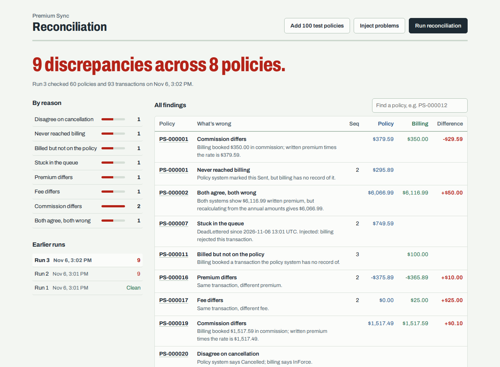
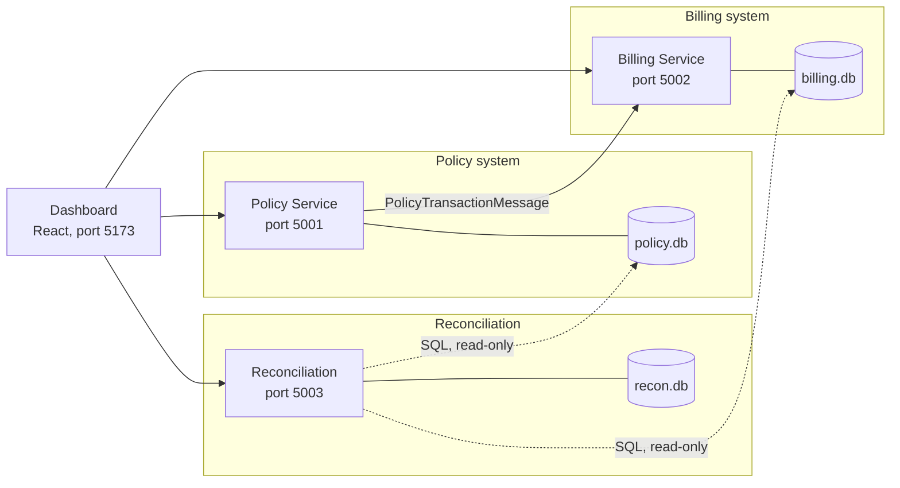
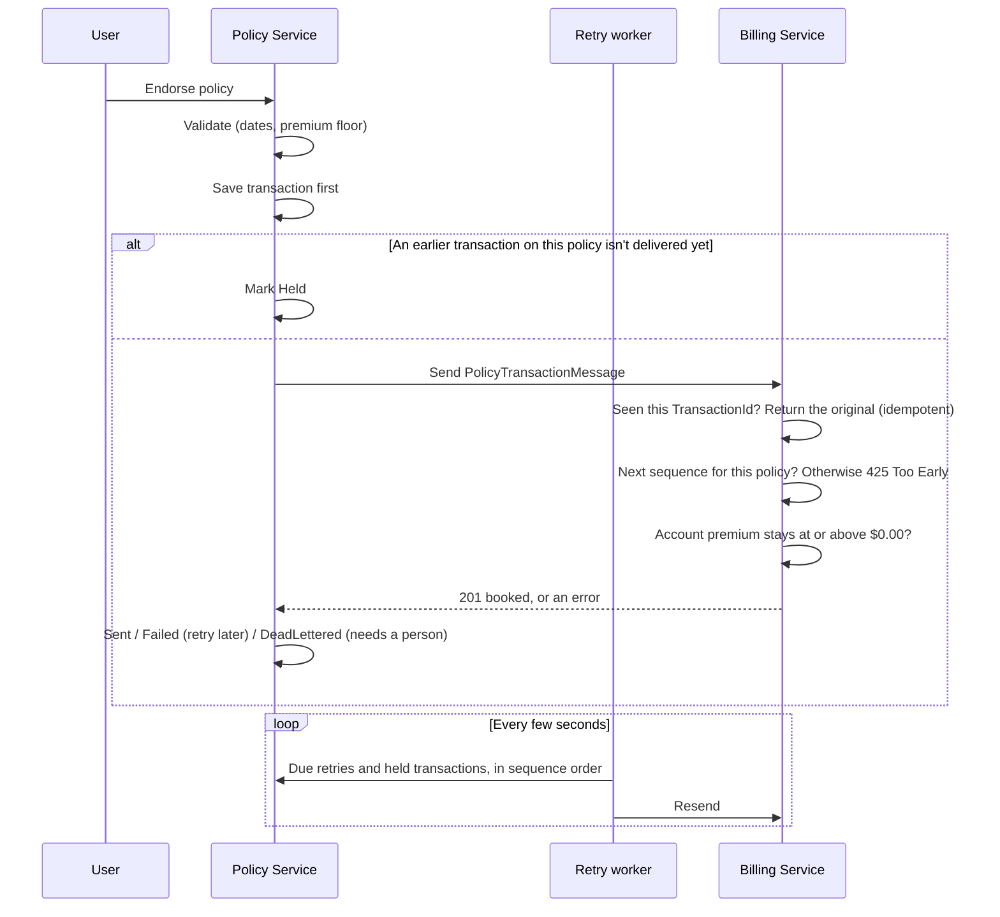
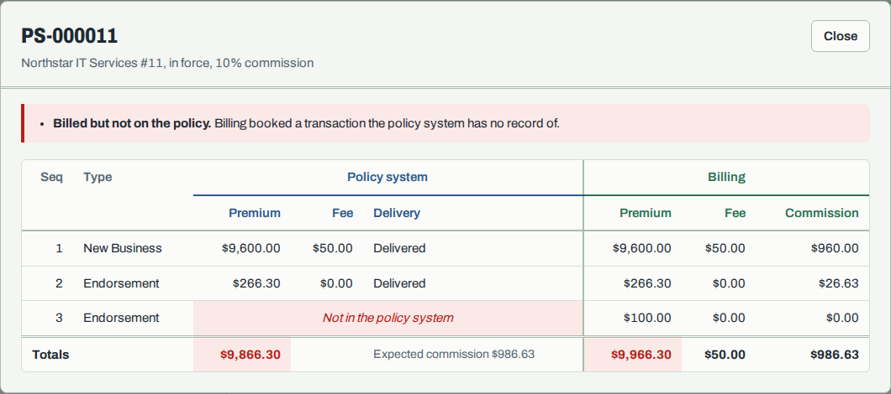

# Premium Sync

A policy-to-billing integration simulator in .NET 10, built to break the way real insurance integrations break, and to catch, explain, and fix each failure.

A mock **policy system** binds, endorses, and cancels policies and sends every premium-bearing transaction to a mock **billing system**. A **reconciliation service** compares the two databases with SQL and reports every disagreement with a reason code, and a **React dashboard** lets you work through the results the way an operations analyst would.



## Why I built it

I've spent 10 years in P&C insurance, from billing operations to a Guidewire upgrade to business analysis on commercial lines, much of it tracing premium, fee, and commission discrepancies across integrated policy, billing, and finance systems. This project rebuilds that problem space from the code side. All data is synthetic and every scenario is generic.

## What broke, and how it's fixed

Each failure was reproduced first, then fixed, tested, and written up as a root cause analysis.

| Failure | Fix | Write-up |
|---------|-----|----------|
| A retried transaction was billed twice, doubling commission | Billing is idempotent on `TransactionId`, backed by a unique index | [RCA 001](docs/rca-001-duplicate-billing.md) |
| Transactions sent during a billing outage were never delivered | Background retries with exponential backoff, then an error queue with manual resend | [RCA 002](docs/rca-002-billing-outage.md) |
| A cancellation reached billing before the endorsement it depended on | The sender holds later transactions; billing only books the next expected sequence | [RCA 003](docs/rca-003-out-of-order.md) |
| Cancelling an endorsed policy over-charged $75.41; commission drifted by cents | Each transaction returns its own unearned share; commission is calculated cumulatively | [RCA 004](docs/rca-004-rounding-drift.md) |
| An endorsement drove premium negative, and the follow-on cancellation left the systems permanently out of sync | Change-date rules and a $0.00 premium floor, checked on both sides before anything changes | [RCA 005](docs/rca-005-zero-and-boundary.md) |
| The reconciliation report itself missed a cancelled policy with no cancellation | Explicit `NULL` handling, and an injected discrepancy plus a test for every reason code | [RCA 006](docs/rca-006-recon-status-gap.md) |

## Architecture



Each service owns its own SQLite database. The only path from policy to billing is the integration contract in `PremiumSync.Contracts`. Reconciliation never writes to either system: it attaches both databases to one read-only connection and compares them.

### Life of a transaction



## What's in it

- **Policy Service:** new business, pro-rata endorsements, and pro-rata cancellations, with delivery status tracked per transaction (`Sent`, `Failed`, `Held`, `DeadLettered`) and sync endpoints for the retry queue, held transactions, and the error queue.
- **Billing Service:** one inbound endpoint that enforces the contract (sequence order, sign rules, whole cents, commission rate range, no negative balances), books premium, and calculates commission.
- **Reconciliation Service:** SQL checks across both databases with a reason code for every finding, saved run history, and an **independent earned-premium recalculation** that catches errors both systems agree on.
- **React dashboard:** a one-line verdict, counts by reason, run history, and side-by-side ledgers for any policy.
- **Dev tools:** generate realistic test policies, demonstrate commission drift, and inject every kind of discrepancy for reconciliation to find.
- **105 tests:** proration, cancellation math, commission, contract validation, retries, ordering, business rules, the reconciliation SQL against real databases, and proof that every injected discrepancy is caught. CI runs them and builds the dashboard on every push.

## Run it

Open in GitHub Codespaces (the dev container installs .NET 10 and Node), then:

```bash
./run.sh
```

| | |
|---|---|
| Dashboard | http://localhost:5173 |
| Policy API docs | http://localhost:5001/scalar |
| Billing API docs | http://localhost:5002/scalar |
| Reconciliation API docs | http://localhost:5003/scalar |

In the dashboard: **Add 100 test policies**, then **Run reconciliation** (clean), then **Inject problems** and **Run reconciliation** again (every reason code shows up). Click any policy number for its side-by-side ledgers.

`requests.http` has a request for every scenario; open it in VS Code with the REST Client extension and click **Send Request**.

Run the tests:

```bash
dotnet test
```

## Reconciliation

`POST /api/recon/runs` runs the queries in [`src/PremiumSync.Reconciliation/Sql`](src/PremiumSync.Reconciliation/Sql). Every finding gets a reason code:

| Reason code | Level | Meaning |
|-------------|-------|---------|
| `MissingInBilling` | Transaction | Policy system marked it Sent; billing has no record of it |
| `StuckInQueue` | Transaction | Undelivered (Failed, Held, DeadLettered) longer than the cutoff |
| `MissingInPolicy` | Transaction | Billing booked something the policy system doesn't have |
| `PremiumMismatch` / `FeeMismatch` | Transaction | Same transaction, different amount |
| `CommissionMismatch` | Policy | Booked commission ≠ written premium × rate (fully synced policies only) |
| `StatusMismatch` | Policy | The systems disagree on whether the policy is cancelled |
| `EarnedPremiumMismatch` | Policy | Written premium doesn't match an independent recalculation from the original annual amounts |

Money is compared in integer cents, and expected commission is calculated with integer math, so SQL rounds exactly the way the C# code does.

**Proving the report works:** `POST /api/dev/inject/all` (Development only) corrupts the databases directly, bypassing every rule in both services, with one discrepancy of each kind on a different healthy policy, and says which findings to expect. Tests do the same for every kind, so a clean report means "nothing is wrong," not "the check is broken."



## Design notes

- **Save, then send.** The policy system records every transaction before calling billing, so an outage never loses data.
- **Billing doesn't trust the sender.** Every contract rule is enforced on the receiving side, even ones the sender also checks.
- **Billing is idempotent.** A retry with the same `TransactionId` and data returns the original result; the same ID with different data is rejected with `409 Conflict`. A unique index backs this up.
- **Failures are classified, retried, then parked.** Temporary failures (billing down, timeouts, 5xx, `425`) retry with exponential backoff. Permanent rejections (`400`, `409`) and transactions that run out of attempts go to an error queue for a person to review and resend.
- **Order is guaranteed per policy.** A transaction waits (`Held`) while an earlier one on the same policy is undelivered, and billing only books the next expected sequence.
- **Bad changes are rejected before anything changes.** A rejected request leaves both systems untouched.
- **Money is `decimal`, rounded to cents, half away from zero.** Cancellation returns each transaction's own unearned share, rounded once. Commission is cumulative (commission on all premium to date minus what's booked), so rounding can't drift.
- **Schema changes use EF Core migrations,** applied by each service on startup.

## Status

All planned work is complete: the happy path, five realistic failure scenarios, reconciliation with injected discrepancies, and the dashboard.

**Backlog**
- Multi-period (multi-year) policies: period numbers in the contract, per-period proration and reconciliation
- A message broker with an outbox in place of direct HTTP between services

## Project layout

```
src/
  PremiumSync.Contracts/       shared message contract and status codes
  PremiumSync.PolicyService/   policy system (port 5001)
  PremiumSync.BillingService/  billing system (port 5002)
  PremiumSync.Reconciliation/  reconciliation (port 5003); SQL lives in Sql/
dashboard/                     React dashboard (port 5173)
tests/PremiumSync.Tests/       xUnit tests
docs/                          root cause analyses and screenshots
requests.http                  sample requests for every scenario
```

**Built with** C#, .NET 10 minimal APIs, Entity Framework Core, SQLite, xUnit, React, Vite, and GitHub Actions.
